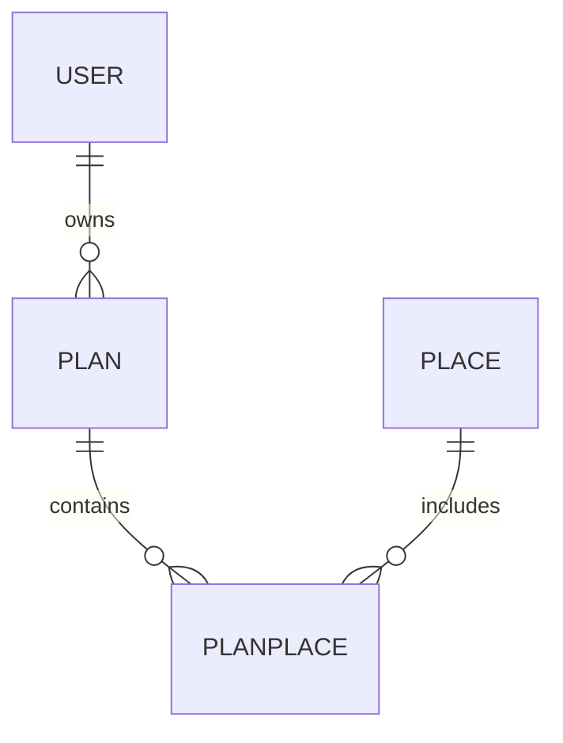
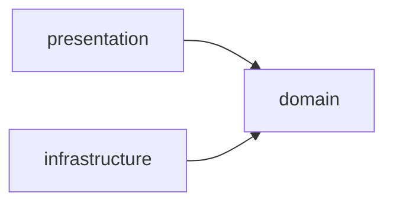

# PlanIt MVP , Architecture & Design

> Platform for discovering and sharing experiences/plans in Buenos Aires.

> **Este documento describe la arquitectura OBJETIVO, no el estado actual.** Varias entidades,
> paquetes y endpoints todavía no existen: `PlanPlace`, `PlanPlaceRestController`, `ShareController`,
> `pages/share/view.html` y la ruta `GET /places/{id}`. Para lo que hay hoy, ver `README.md`; para
> lo que falta, ver `docs/specs/`.
>
> Correcciones ya aplicadas: no hay clustering, Tailwind es
> vendorizado y no CDN, y el popup de lugar **no** lleva link a una página de detalle — los detalles
> van al panel lateral de `/places`.

## Quick Path

1. User registers/logs in → session created
2. Explores places on interactive map (Leaflet + OSM)
3. Creates a plan, adds places with dates/times
4. Shares plan via unique URL
5. Anyone can view shared plan (no login required)

## 1. Domain Model

### Entities



| Entity | Fields | Notes |
|--------|--------|-------|
| **User** | id, email, password, role, active | Already exists |
| **Place** | id, name, description, category, address, imageUrl, latitude, longitude | Seed data for BA |
| **Plan** | id, name, description, date, visibility (PUBLIC/PRIVATE), userId | Owner relationship |
| **PlanPlace** | id, planId, placeId, visitDate, visitTime, order | Junction + scheduling |

### Categories (Place)

`RESTAURANT`, `BAR`, `CAFE`, `MUSEUM`, `PARK`, `SHOPPING`, `NIGHTLIFE`, `CULTURE`, `SPORT`, `OTHER`

### Visibility (Plan)

- `PRIVATE` , only owner can see
- `PUBLIC` , accessible via shared URL without login

## 2. Architecture Layers

```
com.valhalla
├── domain/
│   ├── user/           (User, UserService, UserRepository)
│   ├── login/          (LoginService)
│   ├── place/          (Place, PlaceService, PlaceRepository)
│   ├── plan/           (Plan, PlanService, PlanRepository)
│   ├── planplace/      (PlanPlace, PlanPlaceService, PlanPlaceRepository)
│   └── exception/      (DomainException hierarchy)
├── infrastructure/
│   ├── user/           (UserRepositoryImpl, JpaUserRepository)
│   ├── place/          (PlaceRepositoryImpl, JpaPlaceRepository)
│   ├── plan/           (PlanRepositoryImpl, JpaPlanRepository)
│   ├── planplace/      (PlanPlaceRepositoryImpl, JpaPlanPlaceRepository)
│   └── security/       (CustomUserDetailsService)
├── presentation/
│   ├── login/          (LoginController)
│   ├── user/           (UserController, EditUserRequest)
│   ├── place/          (PlaceController, PlaceRestController)
│   ├── plan/           (PlanController, PlanPlaceRestController)
│   ├── share/          (ShareController)
│   └── shared/         (GlobalExceptionHandler)
├── config/             (JpaConfig, SecurityConfig, BaseWebConfig)
└── MyServletInitializer
```

### Dependency Rule



- Domain layer has NO dependencies on Spring, JPA, or Thymeleaf
- Infrastructure implements domain interfaces (Repository pattern)
- Presentation uses domain services, never infrastructure directly

## 3. Controllers & Routes

### Public Routes

| Method | Route | Controller | View |
|--------|-------|------------|------|
| GET | `/` | LandingController | pages/landing |

### Admin Routes (session required)

| Method | Route | Controller | View |
|--------|-------|------------|------|
| GET | `/admin` | LoginController | redirect → /admin/login |
| GET | `/admin/login` | LoginController | pages/auth/login |
| GET | `/admin/new-user` | LoginController | pages/auth/new-user |
| POST | `/admin/register` | LoginController | redirect → /admin/login |
| GET | `/admin/home` | LoginController | pages/home |
| GET | `/admin/users` | UserController | pages/admin/users |
| GET | `/admin/users/new` | UserController | pages/admin/user-form |
| POST | `/admin/users` | UserController | redirect → /admin/users |
| GET | `/admin/users/{id}/edit` | UserController | pages/admin/user-form |
| PUT | `/admin/users/{id}` | UserController | redirect → /admin/users |
| PUT | `/admin/users/{id}/activate` | UserController | redirect → /admin/users |
| PUT | `/admin/users/{id}/deactivate` | UserController | redirect → /admin/users |
| PUT | `/admin/users/{id}/rotate-password` | UserController | redirect → /admin/users |
| DELETE | `/admin/users/{id}/delete` | UserController | redirect → /admin/users |
| POST | `/admin/validate-login` | Spring Security | redirect → /admin/home |
| POST | `/admin/logout` | Spring Security | redirect → /admin/login |

### User Auth Routes (planificadas — spec 08-AUT)

| Method | Route | Controller | View |
|--------|-------|------------|------|
| GET | `/auth/login` | AuthController | pages/auth/user/login |
| GET | `/auth/register` | AuthController | pages/auth/user/register |
| POST | `/auth/register` | AuthController | redirect → /explore (registro + sesión iniciada) |
| GET | `/auth/forgot-password` | AuthController | pages/auth/user/forgot-password |
| POST | `/auth/recover` | AuthController | pages/auth/user/recovered |
| POST | `/auth/validate-login` | Spring Security | redirect → / (USER) · /admin/home (ADMIN) |
| POST | `/auth/logout` | Spring Security | redirect → /auth/login |

> `/plans` ya tiene `PlanController` (03-PLN), así que el login de un `USER` cae en el listado de
> sus planes.

### Future Authenticated Routes

| Method | Route | Controller | View |
|--------|-------|------------|------|
| GET | `/places` | PlaceController | pages/places/list |
| GET | `/places/{id}` | PlaceController | pages/places/detail |
| GET | `/plans` | PlanController | pages/plans/list |
| GET | `/plans/new` | PlanController | pages/plans/new |
| POST | `/plans` | PlanController | redirect → /plans/{id} |
| GET | `/plans/{id}` | PlanController | pages/plans/detail |
| POST, PUT | `/plans/{id}` | PlanController | redirect → /plans/{id} |
| POST, DELETE | `/plans/{id}/delete` | PlanController | redirect → /plans |
| POST | `/plans/{id}/share` | PlanController | JSON { url } |
| POST | `/plans/{id}/visibility` | PlanController | JSON { visibility } |

> `/plans/{id}` y `/plans/{id}/delete` registran POST además de su verbo propio para que el mismo
> handler atienda el POST crudo y el verbo que reescribe el `HiddenHttpMethodFilter`. El borrado va
> en un sub-path, y no compitiendo con el update por `POST /plans/{id}`, porque su form manda
> `_method=DELETE`: si compartieran ruta, el update —que solo registra POST y PUT— se quedaría sin
> handler en el contenedor real mientras el test de integración, que registra el filtro por su cuenta,
> daría verde. Es el mismo criterio que usa `UserController` con `/admin/users/{id}/delete`.
>
> El filtro lo instala `MyServletInitializer` con `servletContext.addFilter`. No alcanza con
> declararlo como `@Bean`: el auto-registro de beans `Filter` es de Spring Boot, y esto es un WAR de
> Spring MVC plano. Un `@Bean` de filtro ahí es código muerto que en MockMvc —que sí levanta los
> filtros del contexto— aparenta funcionar.
>
> `/share` y `/visibility` siguen sin servirse: pertenecen al ticket de compartir, no a este.

### REST API Routes (CSRF exempt)

| Method | Route | Controller |
|--------|-------|------------|
| GET | `/api/places` | PlaceRestController |
| GET | `/api/plans/{planId}/places` | PlanPlaceRestController |
| POST | `/api/plans/{planId}/places` | PlanPlaceRestController |
| PUT | `/api/plans/{planId}/places/{id}` | PlanPlaceRestController |
| DELETE | `/api/plans/{planId}/places/{id}` | PlanPlaceRestController |
| POST | `/api/plans/{planId}/places/reorder` | PlanPlaceRestController |

### Public Routes (no login)

| Method | Route | Controller | View |
|--------|-------|------------|------|
| GET | `/share/{shortCode}` | ShareController | pages/share/view |

## 4. Frontend Architecture

### Template Structure

```
src/main/webapp/WEB-INF/templates/
├── pages/
│   ├── auth/
│   │   ├── login.html
│   │   └── new-user.html
│   ├── home.html
│   ├── places/
│   │   ├── list.html          (map + sidebar)
│   │   └── detail.html        (detail + embedded map)
│   ├── plans/
│   │   ├── list.html
│   │   ├── new.html           (form)
│   │   └── detail.html        (itinerary + map)
│   └── share/
│       └── view.html          (public view + map)
├── fragments/
│   └── header.html
└── layout.html                (base layout)
```

### Static Resources

El frontend no tiene bundles compilados. Lo propio es solo esto:

```
src/main/webapp/resources/
├── core/js/
│   ├── tailwind-browser.js      (@tailwindcss/browser vendorizado: compila Tailwind en el browser)
│   ├── vue.global.prod.js
│   ├── lucide.min.js
│   ├── add-to-plan.js           agrega un lugar a un plan (módulo)
│   ├── plan-share.js            comparte un plan (script clásico, defer)
│   ├── lib/
│   │   ├── api.js                   csrfToken(), apiFetch(), ApiError
│   │   └── dom.js                   el(): el único constructor de nodos
│   └── pages/
│       ├── places-list.js           mapa, filtros y panel de plan
│       ├── plans-detail.js          mapa, itinerario y catálogo
│       ├── place-import.js          importador OSM
│       └── plans-public.js          mapa público de solo lectura
├── css/
    └── brand.css
└── images/
    └── place-placeholder.svg
```

`lib/` y `pages/` son módulos ES nativos: el browser resuelve `import` sin bundler, y
`BaseWebConfig` mapea `/js/**` a `core/js/`. El contrato que los gobierna es
[guide-js.md](guide-js.md).

**Tailwind es local y vendorizado**: `layouts/base.html` lo carga con
`<script th:src="@{/js/tailwind-browser.js}" defer>`. No hay paso de build de CSS.

**Leaflet es local y vendorizado**, igual que Tailwind, Vue y Lucide: las cuatro vistas con
mapa —`places/list`, `plans/detail`, `admin/place-import` y `plans/public`— cargan
`@{/js/leaflet.js}` y `@{/css/leaflet.css}`, con la 1.9.4 fija en el repo. La versión no queda
en manos de un origen remoto porque `divIcon({ html: elemento })` depende del contrato de 1.9,
y un CDN caído dejaba el mapa muerto. El CSS arrastra `resources/css/images/` por sus `url()`
relativos.

No existe `js/map.js`, `js/places.js`, `js/plan-builder.js` ni `js/share-view.js`: la lógica de
Leaflet vive en los módulos de `resources/core/js/pages/` (`places-list.js`,
`plans-detail.js`, `place-import.js`, `plans-public.js`), no inline en los templates.

### Map Integration (Leaflet + OSM)

| Feature | Implementation |
|---------|----------------|
| Base map | OpenStreetMap tiles (free, no API key), Leaflet 1.9.4 vendorizado (unpkg) |
| Markers | Custom markers by category (color/icon) |
| Popups | Place name y categoría **sin link** — los detalles van al panel lateral de `/places`, sin navegar |
| Responsive | Fullscreen on mobile, sidebar on desktop |
| Filters | Category filter toggles marker visibility |
| Route lines | Leaflet.Polyline between plan places |

## 5. User Flows

### Flow 1: Explore Places

```
1. User clicks "Explorar" → GET /places
2. Map loads centered on Buenos Aires (-34.6037, -58.3816)
3. All places shown as markers on map
4. Sidebar shows place cards (synced with map)
5. User filters by category → markers update
6. User clicks marker → popup with info + "Ver detalle"
7. User clicks "Ver detalle" → GET /places/{id}
```

### Flow 2: Create Plan

```
1. User clicks "Crear plan" → GET /plans/new
2. Form: name, description, date, visibility
3. Map preview shows Buenos Aires
4. User submits → POST /plans → redirect /plans/{id}
5. Plan detail page shows empty itinerary
6. User clicks "Agregar lugares" → redirect /places
7. User clicks place → "Agregar al plan" button
8. POST /plans/{id}/places → redirect /plans/{id}
9. Itinerary updates with new place
```

### Flow 3: Build Itinerary

```
1. User in plan detail → GET /plans/{id}
2. Map shows selected places as numbered markers
3. Line connects places in order
4. Sidebar shows itinerary list
5. User drags to reorder → PUT /plans/{id}/places/reorder
6. User sets date/time per place → inline edit
7. User removes place → DELETE /plans/{id}/places/{planPlaceId}
```

### Flow 4: Share Plan

```
1. User clicks "Compartir" → POST /plans/{id}/share
2. Backend generates shortCode, saves to plan
3. Returns shareable URL: /share/{shortCode}
4. User copies link → feedback "Copiado!"
5. Recipient opens link → GET /share/{shortCode}
6. Public page loads: plan info + itinerary + map
7. No login required, read-only view
```

### Flow 5: View Shared Plan (Public)

```
1. Anonymous user opens /share/{shortCode}
2. ShareController resolves plan by shortCode
3. If plan not found → error page "Plan no encontrado"
4. If plan is PRIVATE → error page "Este plan es privado"
5. If plan is PUBLIC → render share/view.html
6. Map shows all places with markers + route lines
7. Sidebar shows itinerary with dates/times
```

## 6. Key Decisions

| Decision | Choice | Rationale |
|----------|--------|-----------|
| Map library | Leaflet + OpenStreetMap | Free, no API key, open source |
| Share mechanism | Short code in URL | Simple, no token exposure |
| Template engine | Thymeleaf | Already in stack, server-side rendering |
| Session auth | Spring Security | SecurityFilterChain: form login, CSRF, session management (1 per user) |
| DB for places | PostgreSQL (prod) | Already configured, supports PostGIS if needed later |
| Seed data | ApplicationListener | ContextRefreshedEvent seeder, migrate to Flyway later |
| Frontend | Tailwind CSS (vendorizado, compila en el browser) + Vue.js | No build step, fast development. Leaflet también vendorizado |

## 7. Implementation Order

| Phase | Cards | Dependencies |
|-------|-------|--------------|
| 1. Auth & Security | [LOG] | None |
| 1b. User Auth | [AUT] | Phase 1 |
| 2. Places + Map | [PLC] | Phase 1 |
| 3. Plans | [PLN] | Phase 1 |
| 4. Itinerary Backend | [APL-BE] | Phase 2, 3 |
| 5. Itinerary Frontend | [APL-FE] | Phase 4 |
| 6. Share + Public View | [CMP], [VPC] | Phase 5 |
